## About Me

🚀 **AI Engineer | Software Developer | Full-Stack Enthusiast | Problem Solver**

💡 Passionate about building intelligent systems that combine **AI, LLMs, RAG, Agentic AI, Machine Learning, Cloud, and Full-Stack Development** to solve real-world problems.

  

### 🔭 Currently Building
✨ AI Agents • 🤖 LLM Applications • 🧠 RAG Pipelines • 🌐 Full-Stack AI Products • ⚡ Intelligent Automation

### 🌱 Currently Learning
📚 Multi-Agent AI • 🕸️ LangGraph • ☸️ Kubernetes • 🚀 MLOps • ☁️ AWS & GCP • 🔄 CI/CD • 🗄️ Vector Databases • 🧩 Prompt Engineering

### 👯 Open to Collaborate On
🤝 AI/ML • LLM Applications • Open Source • Full-Stack Projects • Computer Vision • Data Science • Agentic AI

### 💬 Ask Me About
🐍 Python • ☕ Java • 🔗 LangChain • 🕸️ LangGraph • 📦 FastAPI • 🐳 Docker • ☁️ AWS • 🗄️ SQL • 🧠 TensorFlow • 📊 Data Analytics • 🤖 AI Agents

### 🎯 Current Goal
Building production-ready AI applications that are scalable, reliable, and solve meaningful real-world problems.

### ⚡ Fun Fact
💙 I genuinely enjoy learning new technologies, experimenting with AI frameworks, and turning ideas into working products faster than I can write them down. 🚀✨

---

> 🌟 **"Code. Learn. Build. Repeat. Every project is another step toward creating technology that makes a difference."**

**🚀 "Great software isn't built by writing more code. It's built by solving the right problems."**

💡 Learn relentlessly. Build fearlessly. Ship consistently.

⭐ *"The best way to predict the future is to build it."*

## Flagship

### Relay · Offline-First Payment Network Simulator

<a href="https://relay-offline-payment-demo.onrender.com/">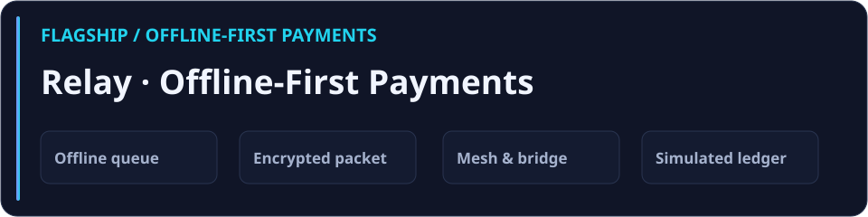</a>

*Java 17 · Spring Boot · JavaScript · H2 · IndexedDB*

Built a UPI-style payment simulator that queues transfers offline and syncs them on reconnect. Used AES-GCM and RSA-OAEP to encrypt payment packets, plus idempotency keys, freshness checks, and transactional ledger updates to handle duplicate and concurrent arrivals.

<a href="https://relay-offline-payment-demo.onrender.com/">Live demo</a> · <a href="https://github.com/ankush-48/relay-offline-payment-demo">Source code</a>

#### Architecture and payment flow

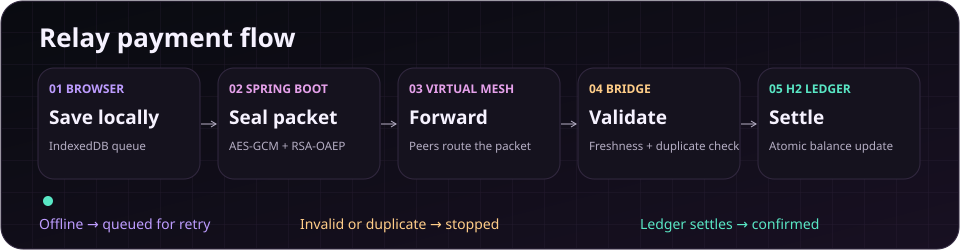

1. **Queue locally.** The browser saves a payment request in IndexedDB, with a localStorage fallback. The request waits for connectivity and an active demo session.
2. **Seal and forward.** The server encrypts the payload with AES-GCM, wraps the key with RSA-OAEP, and sends the envelope through the simulated peer mesh.
3. **Validate at the bridge.** The bridge decrypts the request, checks freshness and idempotency, and attempts settlement. A transient sync failure leaves the request available for retry.
4. **Confirm at the ledger.** The simulated ledger validates balances and updates them in a transaction. The UI shows confirmation after a settled response.

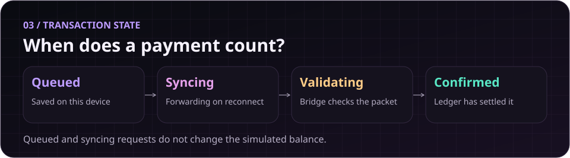

#### Try it live

[Open guest sandbox](https://relay-offline-payment-demo.onrender.com/) · [Dashboard and cashflow](https://relay-offline-payment-demo.onrender.com/#/dashboard) · [Send a simulated payment](https://relay-offline-payment-demo.onrender.com/#/dashboard/send) · [Live network monitor](https://relay-offline-payment-demo.onrender.com/#/dashboard/system)

Enter **Guest access** first. In the network monitor, use **Refresh telemetry** to inspect API response time, mesh nodes and the local queue. The dashboard shows simulated cashflow and ledger activity after settlement.

#### Relay in action

<a href="https://raw.githubusercontent.com/ankush-48/ankush-48/main/assets/projects/relay-home.png">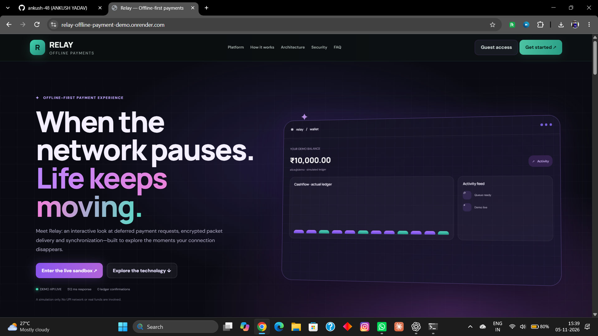</a> <a href="https://raw.githubusercontent.com/ankush-48/ankush-48/main/assets/projects/relay-lifecycle.png">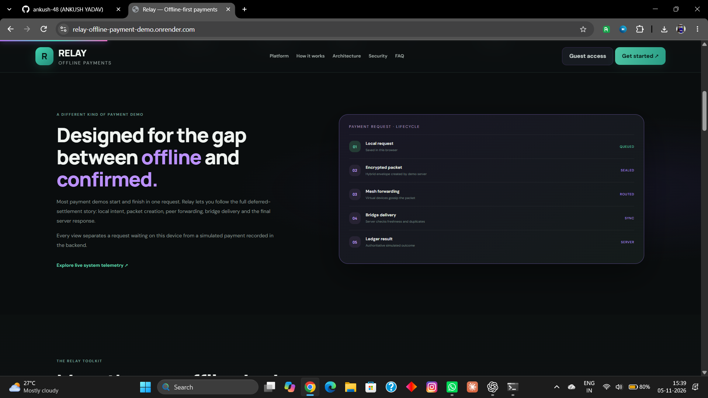</a>
 
<a href="https://raw.githubusercontent.com/ankush-48/ankush-48/main/assets/projects/relay-dashboard.png">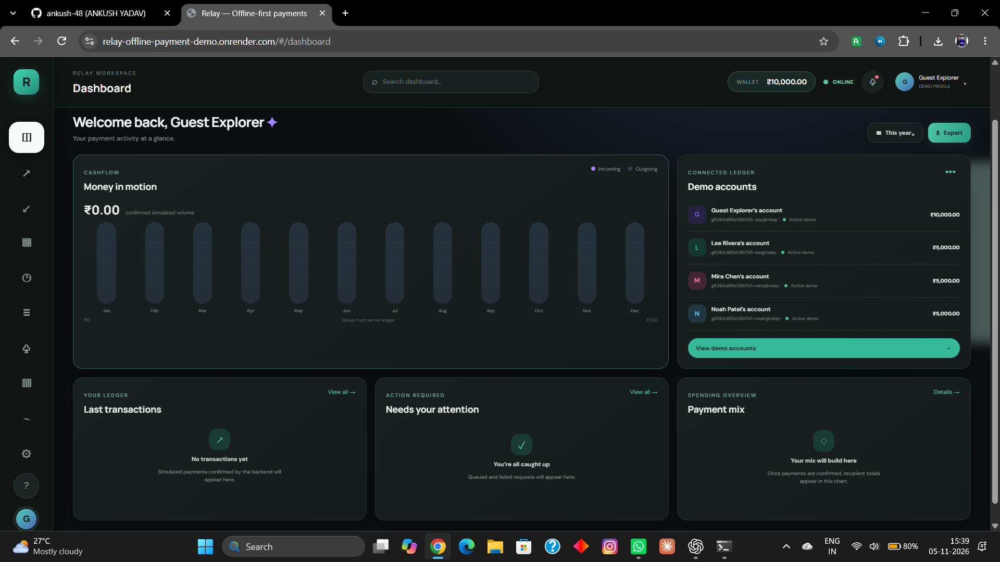</a> <a href="https://raw.githubusercontent.com/ankush-48/ankush-48/main/assets/projects/relay-send.png">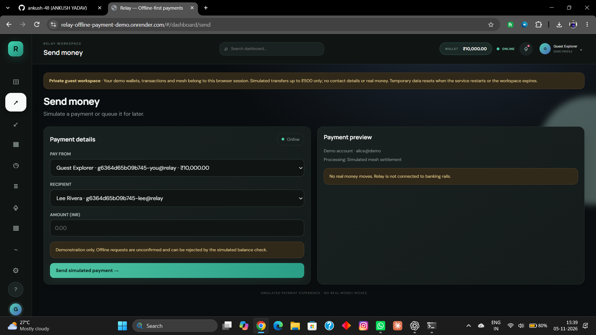</a>
 
<a href="https://raw.githubusercontent.com/ankush-48/ankush-48/main/assets/projects/relay-receive.png">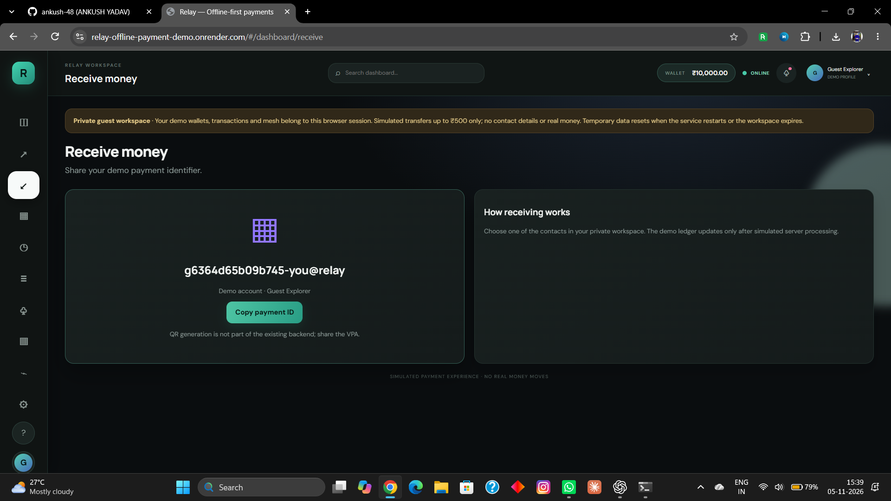</a> <a href="https://raw.githubusercontent.com/ankush-48/ankush-48/main/assets/projects/relay-scan.png">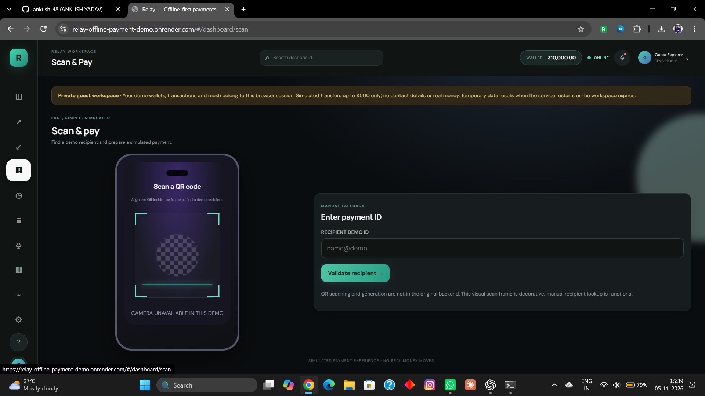</a>
 
<a href="https://raw.githubusercontent.com/ankush-48/ankush-48/main/assets/projects/relay-network.png">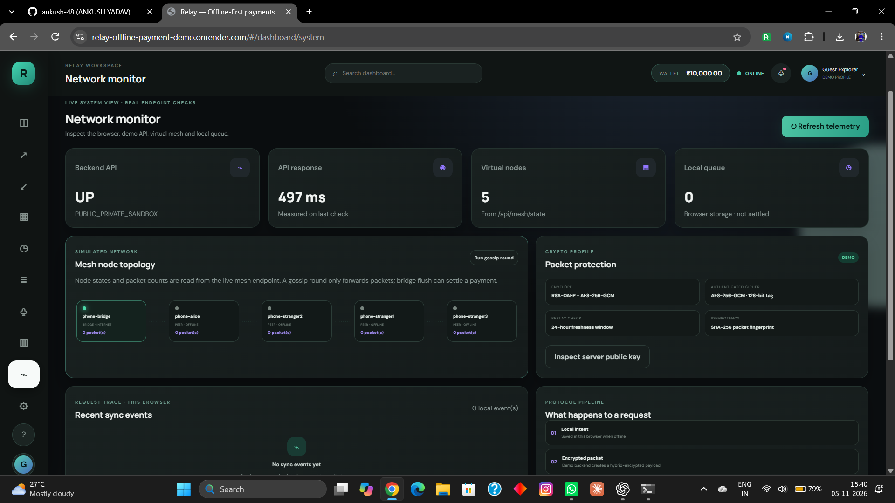</a>

## Selected Work

<table>
<tr>
<td width="50%" valign="top">
<a href="https://k7v3m9q2-five.vercel.app">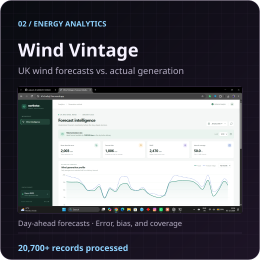</a> 
<a href="https://k7v3m9q2-five.vercel.app">Live dashboard</a> · <a href="https://github.com/ankush-48/k7v3m9q2">Code</a>
</td>
<td width="50%" valign="top">
<a href="https://github.com/ankush-48/AI-Multi-Agent-Social-Debate-System">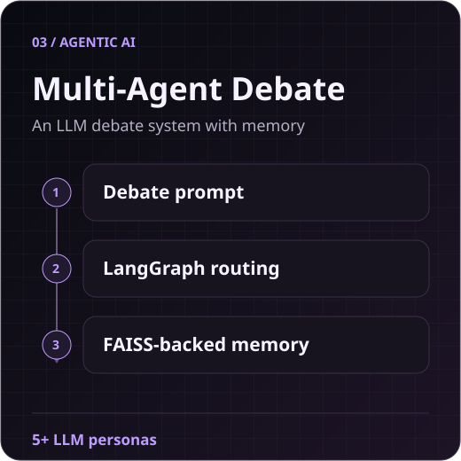</a> 
<a href="https://github.com/ankush-48/AI-Multi-Agent-Social-Debate-System">Code</a>
</td>
</tr>
<tr>
<td width="50%" valign="top">
<a href="https://github.com/ankush-48/ai-project-health-reporting-agent">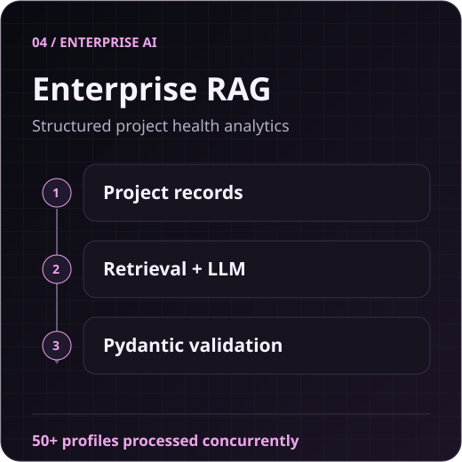</a> 
<a href="https://github.com/ankush-48/ai-project-health-reporting-agent">Code</a>
</td>
<td width="50%" valign="top">
<a href="https://github.com/ankush-48/Containerized-Flask-REST-API-with-Kubernetes-MongoDB">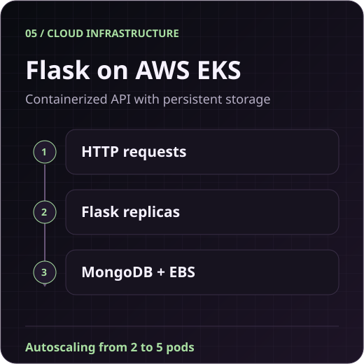</a> 
<a href="https://github.com/ankush-48/Containerized-Flask-REST-API-with-Kubernetes-MongoDB">Code</a>
</td>
</tr>
<tr>
<td colspan="2" align="center">
<a href="https://github.com/ankush-48/Fear-Greed-vs-Profit-A-Behavioral-Analysis-of-Crypto-Trading">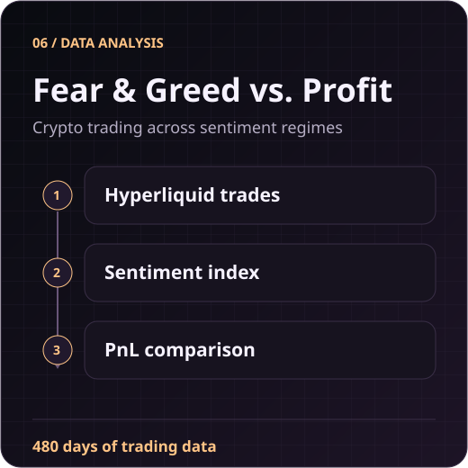</a> 
<a href="https://github.com/ankush-48/Fear-Greed-vs-Profit-A-Behavioral-Analysis-of-Crypto-Trading">Code</a>
</td>
</tr>
</table>

## Achievements

- **CICADA 2023 Hackathon** · Led a four-person team through a 24-hour build at Atria Institute of Technology.
- **CodeChef Silver Problem Solver** · Solved 270+ data structures and algorithms problems in Java and Python.
- **Presidency University Innovation Expo** · Selected among the top 70 of 450 teams in May 2023.

[CodeChef](https://www.codechef.com/users/ankush48) · [LeetCode](https://leetcode.com/u/Ankush48/)

## Experience

### Mphasis Ltd · Associate Software Engineer Intern

*Feb 2026 – Apr 2026 · Bengaluru, India*

- Built 12+ REST endpoints with Java and Spring Boot, with sub-200 ms response times in concurrent request benchmarks.
- Reduced database response times by 20% across 15+ relational tables by optimizing MySQL queries and tuning Hibernate mappings.
- Improved page-load speed by 25% across 10+ responsive frontend modules built with HTML, CSS, Bootstrap, and TypeScript.

### Evoastra Ventures · Data Science Intern, Data &amp; Pipelines

*Jul 2025 – Aug 2025 · Remote*

- Automated daily data collection with BeautifulSoup and Selenium, processing 50,000+ data points and saving 15+ hours of manual research per week.
- Built a DenseNet201 CNN–LSTM image captioning model and served it through Flask.
- Improved inference speed by 30% in benchmarks through tuning, custom tokenization, and optimized feature extraction.

## Live from GitHub

<a href="https://github.com/ankush-48#contributions-calendar">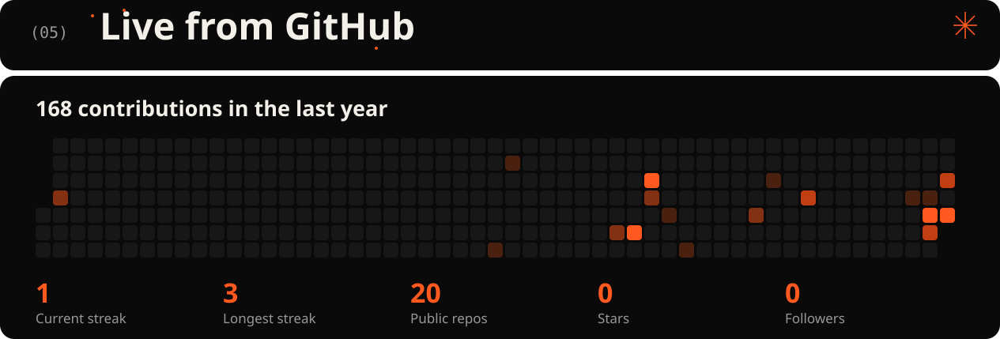</a>

## Education

**Presidency University**, Bengaluru  
B.Tech in Computer Science and Engineering · Dec 2022 – Nov 2026 · CGPA 7.7/10

## Certifications &amp; Training

- **AWS** · AWS Certified Cloud Practitioner
- **Google Cloud** · GenAI Studio
- **Microsoft** · Azure Essentials, Azure AI Essentials, Career Essentials in Software Development, and Career Essentials in Data Analysis
- **HP** · HP Data Analytics
- **Cisco** · Networking Basics

## Tech Stack

- **LLMs & agents** · LangChain, LangGraph, RAG, FAISS, Sentence-Transformers, Groq, and Llama 3.3.
- **Software & infrastructure** · Spring Boot, Hibernate, REST APIs, Docker Compose, AWS EKS, and SQL.
- **Data & ML** · Exploratory data analysis, feature engineering, statistical modeling, CNNs, LSTMs, Tableau, and Seaborn.

### Languages & Markup

### Cloud & Hosting

### Web, Mobile & Backend

### Databases & Data Platforms

### AI, Data Science & Analytics

### Design & Graphics

### Developer Tools, Testing & Infrastructure

## More GitHub Stats

<table>
<tr><td width="50%"></td><td width="50%"><a href="https://github.com/ankush-48#contributions-calendar">View GitHub’s contribution calendar</a></td></tr>
<tr><td width="50%"></td><td width="50%"></td></tr>
<tr><td width="50%"></td><td width="50%"></td></tr>
<tr><td width="50%">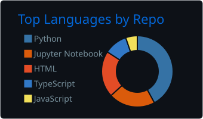</td><td width="50%">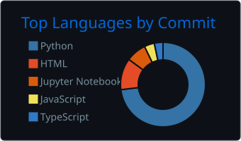</td></tr>
</table>

Charts refresh on a daily schedule. Each chart keeps its last successful copy if its provider is unavailable.

<a href="https://ankush-yadav.netlify.app/">Portfolio</a> · <a href="https://linkedin.com/in/ankush-yadav48">LinkedIn</a> · <a href="mailto:ay3068756@gmail.com">Email</a>

